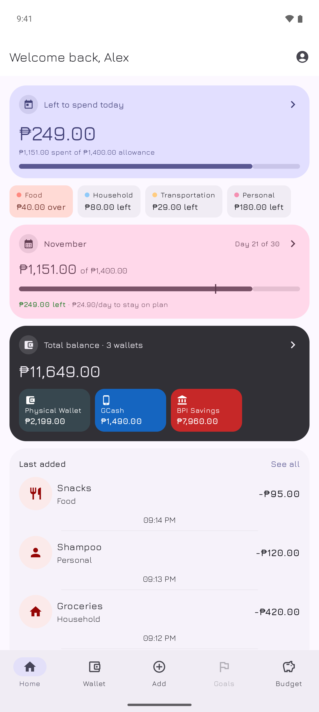
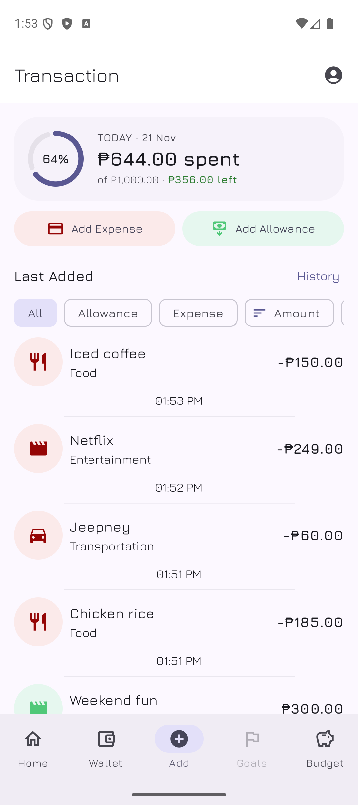
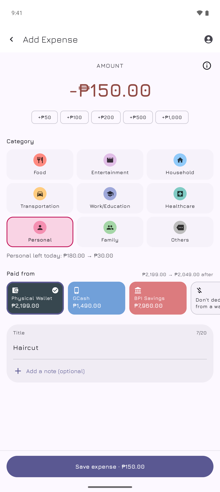
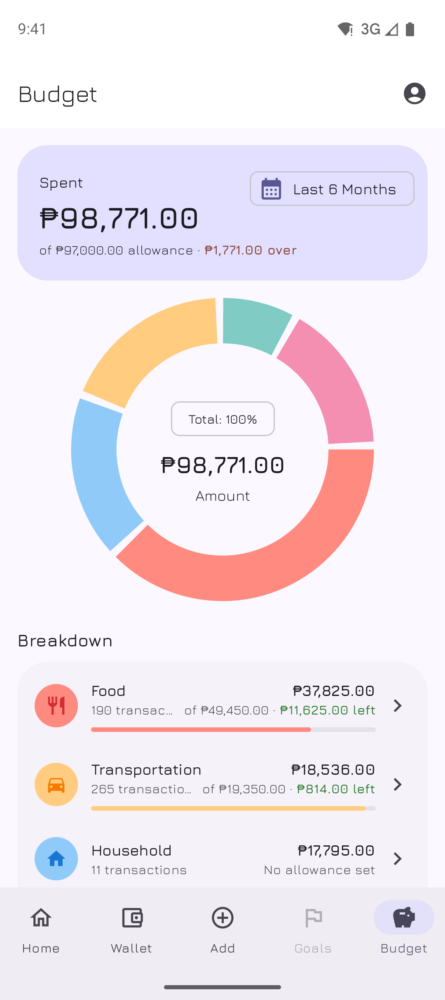
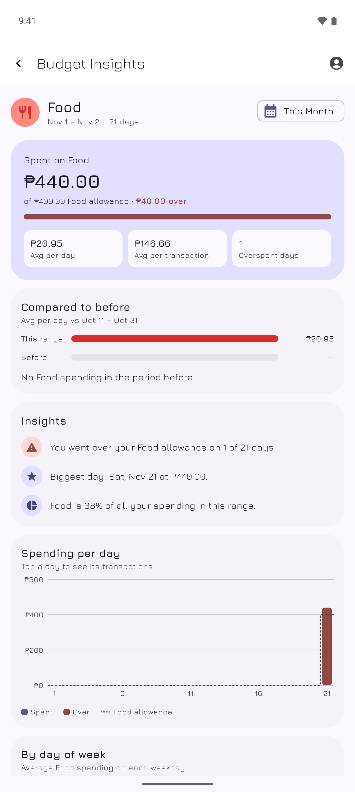
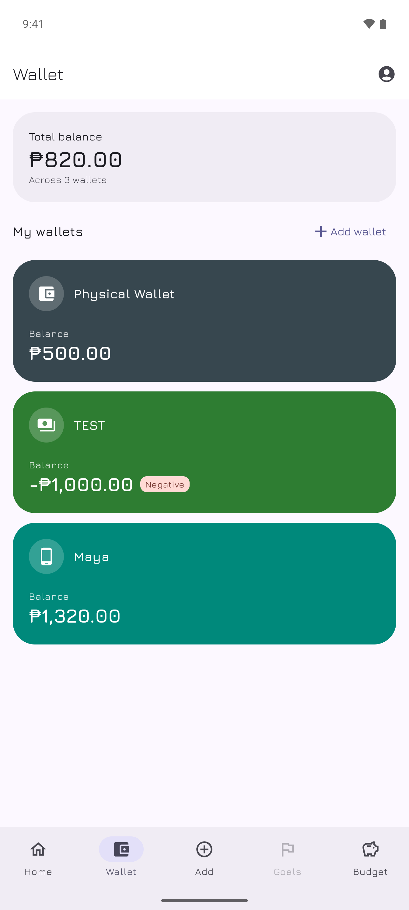
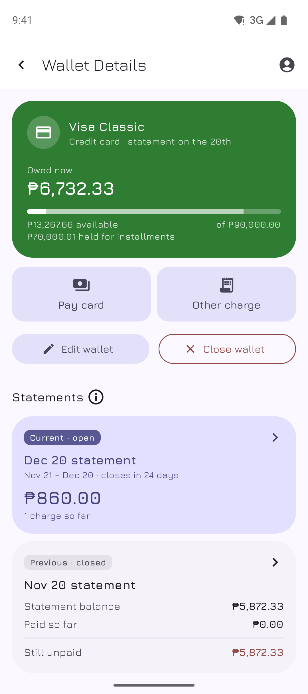
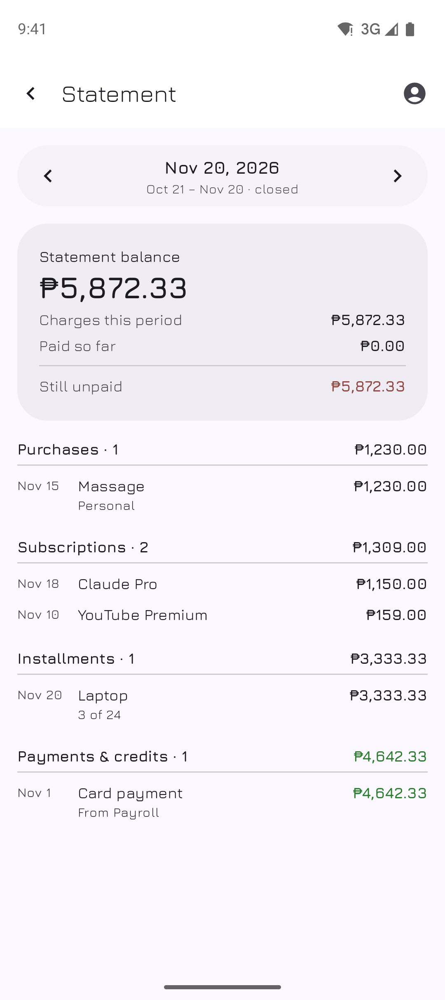
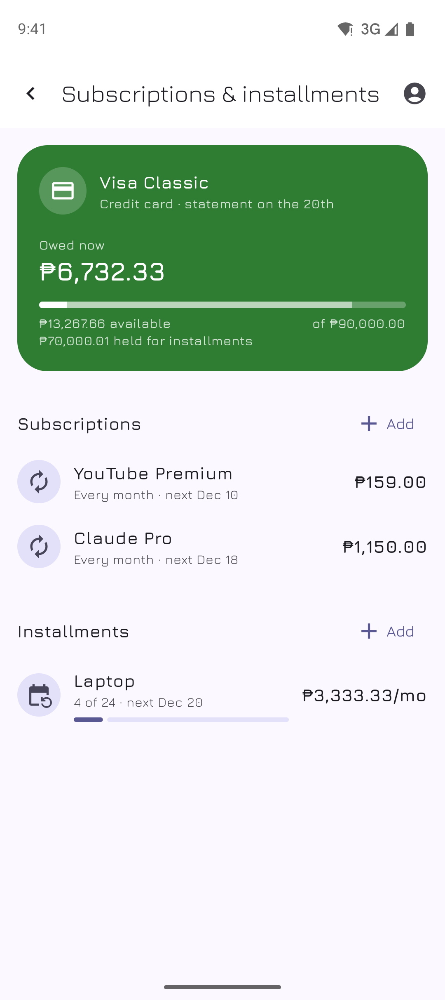

# DenuSpend

An Android app that tracks your spending habits and keeps a history of it. No more impulsive buying: give yourself a daily allowance per category, log what you spend, and see where your money actually goes.

**[⬇️ Download the latest APK](https://github.com/denuden/DenuSpend/releases/latest)** (Android 10+). Every version is on the [Releases](https://github.com/denuden/DenuSpend/releases) page.

  
  
  

  
  
  

  
  
  

🎬 [Watch a 1:40 demo](docs/media/demo.mp4): log an expense and see Home update, explore 6 months of Budget and Food insights, open a credit card statement, then add an installment that starts 3 months later.

## Features
- **Home dashboard.** One glance answers "how much can I still spend today?", with a chip per category, how the month is pacing ("₱277/day to stay on plan"), your total balance across wallets, and what you added last. Every card opens the screen with the details.
- **Daily allowance per category.** Set how much you give yourself today for Food, Transportation, Entertainment… and see how much is left as you spend. Save allowances you use often as templates and add them in one tap.
- **Works offline.** Saves go through right away without a connection and sync when you're back online.
- **Fast expense entry.** A big amount with quick +₱50 to +₱1,000 chips, a category grid, and live hints like "Food left today: ₱315 → ₱165" and "GCash ₱1,800 → ₱1,551 after".
- **Wallets.** Track real money across cash, bank, e-wallet and cards. Each expense says which wallet paid, and the balance updates automatically (edits and deletes refund correctly). Log money in, money out and transfers between wallets, each with its own history.
- **Credit cards.** Owed amount, limit and what's still available. Statements follow your card's statement day like the bank's: the open cycle, the last closed statement with "Paid so far" and "Still unpaid", and a payment due date that warns you when it's close or overdue.
- **Subscriptions and installments.** Add Netflix or a 24-month laptop plan once, and each charge posts itself on the right day and lands on the right statement. Installments still to come are held against your limit, like banks do, and an installment can start a few months later (buy now, pay later).
- **Budget insights.** Spending vs. allowance for any range (last 7 days, this month, last 6 months, a custom range…), a category donut chart, a per-category breakdown, and a comparison with the period before.
- **History.** Every day grouped by month, with each day's transactions in a sheet. Edit or delete anything.
- **Account.** Email sign-in with verification and password reset, profile photo and name, change email or password, and full account deletion (removes all your data).

## Tech stack
- **Kotlin**, **Jetpack Compose**, **Material 3**
- **MVVM + MVI-style events**, **Hilt** for dependency injection
- **Coroutines + Flow**: Firestore live listeners as `callbackFlow`, started and stopped with the screen lifecycle
- **Firebase Auth** and **Cloud Firestore**
- **Type-safe Navigation Compose** with nested graphs and a session-driven root (Splash / Auth / Main)
- **Encrypted DataStore** for local settings
- **R8** minified release builds

## Design notes
- **Cheap reads by design.** Every transaction write also updates a per-day and a per-month summary doc in the same Firestore batch. Budget reads those summaries instead of every transaction, so a 6-month view costs about 12 reads instead of about 184.
- **Money is stored as whole cents** (`Long`), never floating point.
- **Security rules are owner-only.** Every document carries its `userId`, and each user can only read and write their own data.

## About
Built by me from the ground up: the app structure, coding patterns, and the Firestore schema for the Add and Budget modules. Later features and polish were made together with Claude (Anthropic's AI) as a coding partner.

## License
Copyright (c) 2026 Von Denuelle L. Tandoc (denuden). All rights reserved.
The code is public for viewing only. See [LICENSE](LICENSE).
